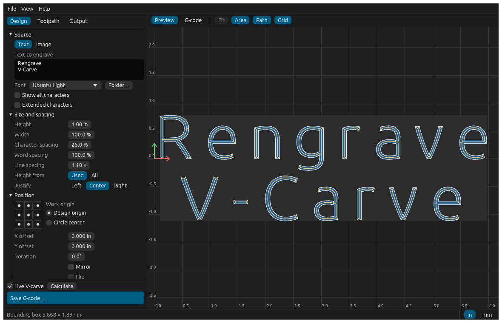
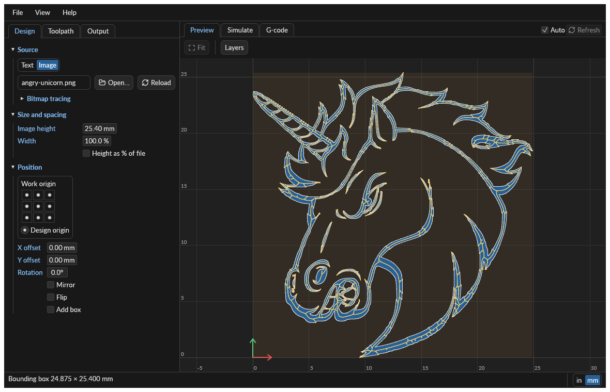
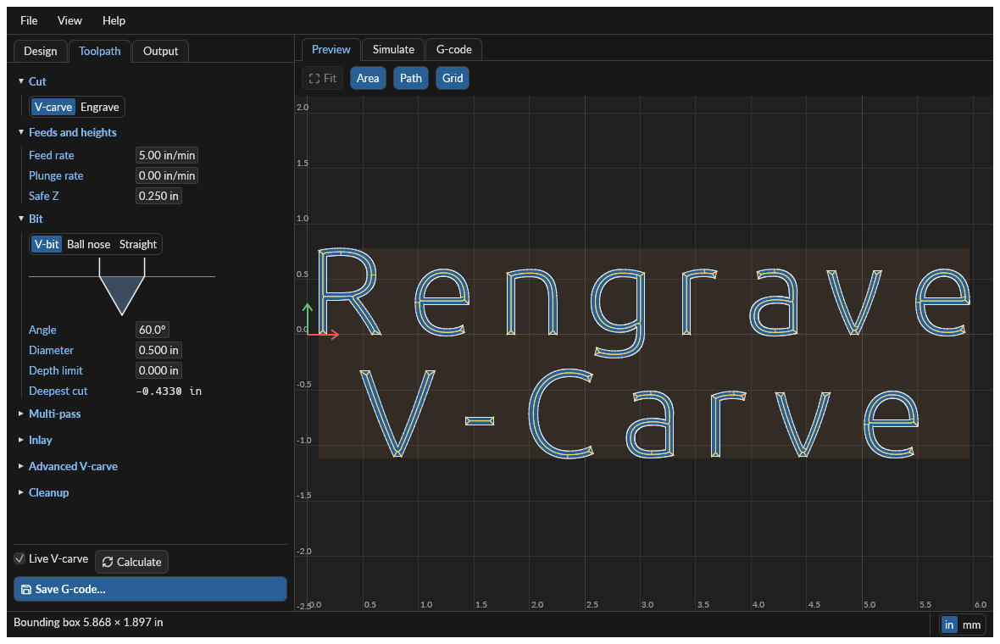
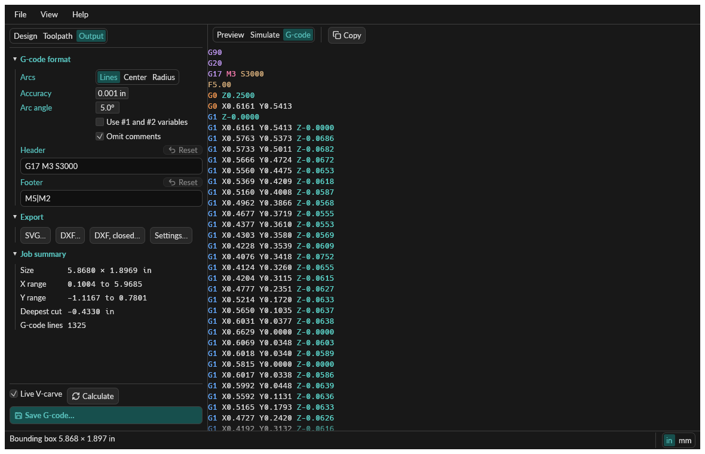
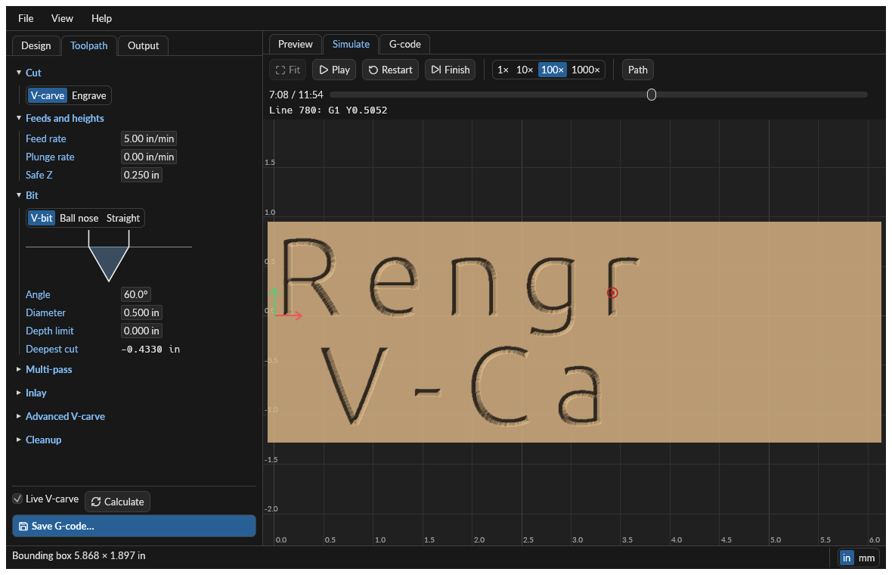
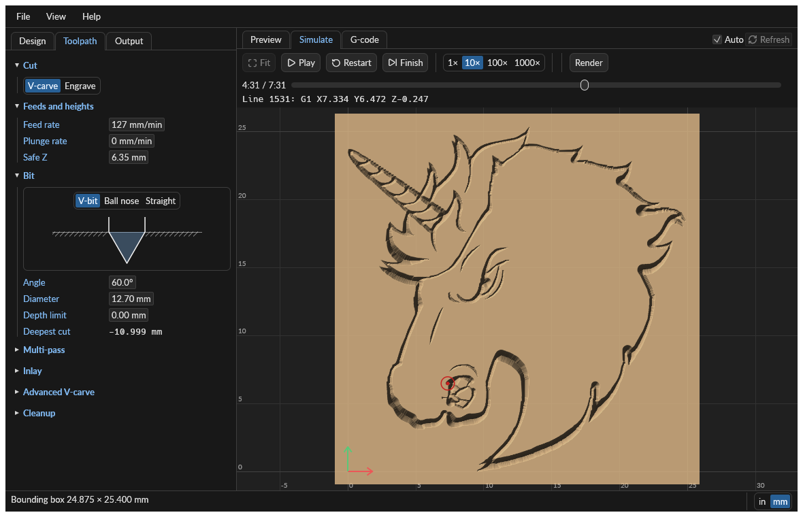

# rengrave

Generate engraving and V-carve G-code from text and images, from the command line or a desktop
application.

rengrave is a Rust port of [F-Engrave](https://www.scorchworks.com/Fengrave/fengrave.html) 1.78
by Scorch. The toolpath engine reproduces the original's G-code line for line across a suite of
reference programs. It runs with no helper programs and uses the fonts installed on your computer.



## Features

- **V-carving** with V-bits, ball-nose bits, and straight bits, including multi-pass roughing,
  depth limits, and prismatic cuts for inlays
- **Engraving** of outlines at constant depth
- **Text** in any installed font, or in CXF stroke fonts and TrueType/OpenType files you add to
  your font library, with justification, spacing, rotation, mirroring, and placement on a circle
- **Images**: DXF drawings, plus PNG, BMP, PBM/PGM/PPM, JPEG, GIF, and TIFF bitmaps through a
  built-in tracer or `potrace`
- **Cleanup operations** that clear flat regions with a straight bit and tidy edges with a V-bit
- **Output** as G-code with optional arc fitting (`I`/`J` or `R`), plus SVG and DXF outlines
- **Simulation** of the G-code program, showing the tool moving and the carved result
- **Settings files** in the `fengrave_set` format, including settings embedded in the G-code.
  They name the font as `system:<family>` or `user:<name>`, so they are not interchangeable with
  F-Engrave's, which names a font file

## Getting started

Building requires a [Rust toolchain](https://rustup.rs) (edition 2024). On Linux, the desktop
application also needs the [usual `eframe` system
libraries](https://github.com/emilk/egui/tree/main/crates/eframe#usage).

```bash
cargo build --release
```

This produces two programs in `target/release`: `rengrave-cli` and `rengrave`.

### Desktop application

```bash
cargo run --release --bin rengrave
```

On macOS, build a `Rengrave.app` bundle with [cargo-bundle](https://github.com/burtonageo/cargo-bundle)
(`cargo install cargo-bundle`). The bundle gives the application menu its "Rengrave" name. It has
no icon yet.

```bash
cd crates/rengrave_gui && cargo bundle --release
```

The app is written to `target/release/bundle/osx/Rengrave.app`.

The window shows the design, its carved area, and the tool path, recalculating after each change.
Choose the text and font on the **Design** tab and the bit on the **Toolpath** tab, then choose
**File ▸ Save G-code…**. The application starts in millimeters with the text "F-engrave" and
"Fan!", and **File ▸ New** returns to that.

To carve an image instead, choose **Image** under Source and open a DXF drawing or a bitmap. Here
the PNG `angry-unicorn.png` is traced and V-carved:



The **Toolpath** tab sets the feeds, the bit, and optional multi-pass, inlay, and cleanup
operations:



The **G-code** view shows the program with syntax highlighting. Select text and copy it, or use
the **Copy** button to copy it all:



| Action | Control |
| --- | --- |
| Pan | Drag the preview |
| Zoom | Scroll or pinch; `Page Up` / `Page Down` |
| Fit design | Double-click the preview; `Ctrl`+`0` |
| Reload the source file and calculate | `F5` |
| Stop calculating | `Esc` |
| Save G-code | `Ctrl`+`S` |
| Copy G-code | `Ctrl`+`G` |
| Open image | `Ctrl`+`O`, or drop a file on the window |

The **Simulate** tab plays the G-code program and cuts into a model of the stock. Scrub in either
direction, or press **Finish** to see the result. Run times are estimates that ignore acceleration.





A file path on the command line (`rengrave job.ngc`) opens that settings file, font, or image.

### Your fonts

Installed fonts are always listed under **System fonts**. To use a font file that is not
installed (including CXF stroke fonts), choose **Manage fonts…** in the font list, or **Edit ▸
Application settings…**, and add it; it then appears under **User fonts**. Dropping a font file on
the window adds it too. Your fonts are kept in `settings.yaml` in the application's configuration
folder (`~/Library/Application Support/Rengrave` on macOS, `%APPDATA%\Rengrave\config` on
Windows, `~/.config/rengrave` on Linux), which `rengrave-cli` reads as well, so
`--font user:<name>` works in both. Set `RENGRAVE_SETTINGS` to use another file.

### Command line

V-carve some text in the default system font, in millimeters:

```bash
rengrave-cli gcode --text "Hello" --mode v-carve --units mm --height 25 --bit-dia 12.7 --output hello.ngc
```

V-carve a drawing, centered on the origin:

```bash
rengrave-cli gcode --image logo.dxf --mode v-carve --height 2 --origin mid-center --output logo.ngc
```

Use an installed font, or a font file for this run only, with two lines of centered text (`|`
starts a new line):

```bash
rengrave-cli gcode --font "system:Helvetica" --text "One|Two" --justify center --mode v-carve --output two.ngc
```

```bash
rengrave-cli gcode --font-file /path/to/font.ttf --text "One|Two" --justify center --mode v-carve --output two.ngc
```

Write the job's settings, then reuse them:

```bash
rengrave-cli settings --text "Hello" --mode v-carve --output job.cfg
```

```bash
rengrave-cli gcode --settings job.cfg --output hello.ngc
```

The commands are:

| Command | Writes |
| --- | --- |
| `gcode` | The G-code program |
| `cleanup` | The G-code for a cleanup operation (`--tool straight` or `--tool v-bit`) |
| `svg` | The outline as SVG |
| `dxf` | The outline as DXF (`--close-loops` stitches open chains) |
| `settings` | A settings file |
| `fonts` | A list of installed fonts, or a description of one font file |

Output goes to standard output unless `--output` is given. `rengrave-cli gcode --help` lists every
option. Any setting without its own option can be set by its settings-file name, as in
`--set v_stp_crner=210`.

> **Check before cutting.** Lengths default to inches. Preview a new program in a G-code viewer
> and confirm the units, origin, and depths suit your machine.
>
> **Controllers:** the defaults target [FluidNC](http://wiki.fluidnc.com): the header is
> `G17 M3 S3000`, which starts the spindle, and the footer is `M5|M2`. FluidNC rejects a whole line
> if it contains a code it does not support, so rengrave warns about any such code in a custom
> header or footer. On LinuxCNC, the original program's header gives path blending:
> `--set "gpre=G17 G64 P0.001 M3 S3000"`.

## Project layout

| Path | Contents |
| --- | --- |
| [`crates/rengrave_core`](crates/rengrave_core) | The toolpath engine, as a library |
| [`crates/rengrave_cli`](crates/rengrave_cli) | The `rengrave` command |
| [`crates/rengrave_gui`](crates/rengrave_gui) | The `rengrave` application, built with [egui](https://www.egui.rs) |
| [`docs/PORTING.md`](docs/PORTING.md) | How the code maps to the original, and how it was verified |
| [`docs/UX_REVIEW.md`](docs/UX_REVIEW.md) | The design review behind the application's interface |
| [`docs/DECISIONS.md`](docs/DECISIONS.md) | Decisions made during the port, for review |
| [`COPYRIGHT.md`](COPYRIGHT.md) | Copyright and license of each file |
| [`vendor`](vendor) | Third-party crates kept in the repository, for the simulator |
| [`tools/parity`](tools/parity) | Regenerates reference programs from the original |

## Using the engine

`rengrave_core` can be used on its own:

```rust
use rengrave_core::{CutType, Job, Progress, Settings};

let settings = Settings {
    text: "Hi".into(),
    cut_type: CutType::VCarve,
    ..Settings::default()
};
let job = Job::load(settings)?;
let gcode: Vec<String> = job.generate_gcode(&Progress::none())?;
# Ok::<(), rengrave_core::Error>(())
```

## Testing

```bash
cargo test --workspace
```

The suite includes unit tests of the computations, line-for-line comparison with the original's
output, end-to-end runs of the command, and tests that drive the whole desktop application through
[`egui_kittest`](https://crates.io/crates/egui_kittest). Screenshots need a GPU, so they run
separately:

```bash
cargo test -p rengrave_gui --features screenshots --test screenshots
```

## License

Licensed under the [GNU General Public License, version 3 or later](LICENSE), as is F-Engrave, of
which this is a derivative work. F-Engrave is copyright Scorch. Files state their own terms, and
[`COPYRIGHT.md`](COPYRIGHT.md) lists which are ports, which are new, and which third-party code keeps
its own license, such as the MIT-licensed crates in [`vendor`](vendor).
